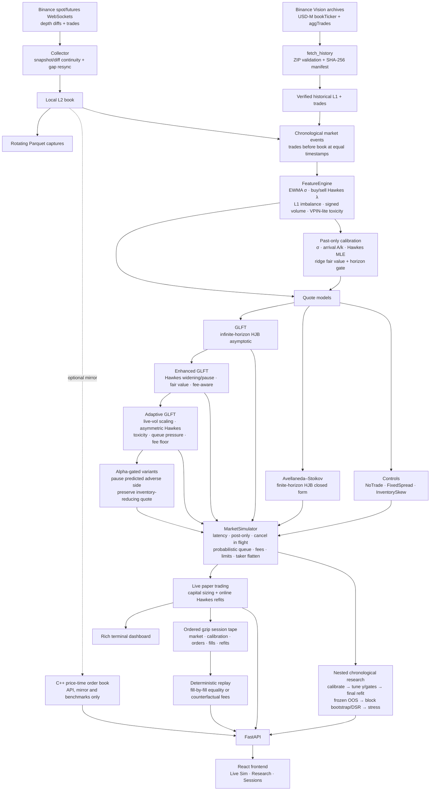

# LOB-X

A market-making research stack for crypto futures:
* a C++20 limit order book;
* a live Binance data pipeline;
* calibrated Avellaneda–Stoikov and GLFT market makers with Hawkes order-flow
  features;
* an event-driven execution simulator with latency and queue position;
* a research protocol with out-of-sample tests and bootstrap confidence
  intervals.

Everything is paper trading. No order is ever sent to an exchange.

## Headline result

On five real four-hour Binance BTCUSDT futures windows (tick-by-tick L1 plus
every trade; calm, crash, rally, volatile and selloff):

* **Joining the touch loses money at every fee tier**, including the 0.5 bp
  market-maker rebate. Adverse selection over 5 s (0.5–0.8 bp) is far larger
  than a one-tick spread (0.014 bp).
* **Calibrated GLFT/AS quoting loses far less than touch-quoting.** At the
  rebate tier plain GLFT is profitable out-of-sample in the crash:
  * GLFT +$4.6, 95% CI [−0.06, +8.6];
  * AS +$1.2, 95% CI [+0.04, +2.3].
* **The adaptive alpha-gated GLFT is positive in three outer holdouts** at the
  rebate tier: calm +$0.026, crash +$0.135 and selloff +$0.437. The selloff
  95% bootstrap CI is [+$0.054, +$1.067], but other regimes are negative, so
  this is not yet a universal or deployable winner.
* **Latency bounds the edge.** The crash candidate remains positive at a
  50+50 ms stress (+$0.202) but loses at 150+150 ms (−$0.742).
* **A naive fill model is the biggest error source.** Assuming we are first in
  the queue turns touch-quoting's −$2.9 into +$54 on the same data.
* **Ordinary VIP0 profitability is not established.** One selloff result was
  +$0.344 on only five fills with a confidence interval spanning large losses;
  it is rejected as insufficient evidence.

Details, tables and limits: [`docs/research.md`](docs/research.md).

## What is in here



| Component | Where | Notes |
|---|---|---|
| Matching engine | `backend/cpp` | Price-time priority, GTC/IOC/FOK, O(1) cancel. 1.77M ops/s native; p99 add 1.4 µs, cancel 0.5 µs. Catch2 tests. [docs](docs/matching_engine.md) |
| Market data | `lobx/market_data` | Binance depth sync (snapshot + sequence-checked diffs, resync on gaps), trade stream, Parquet writer |
| Models | `lobx/models` | AS, GLFT closed form, Hawkes intensity and MLE. [docs](docs/models.md) |
| Calibration | `lobx/analytics/calibration.py` | σ, A and k from market-order depth, Hawkes MLE per side, ridge fair value |
| Simulator | `lobx/execution` | Multi-account paper exchange. [docs](docs/execution_model.md) |
| Research | `lobx/backtest` | Protocol, reports, bootstrap. [results](results/research/SUMMARY.md) |
| Live | `lobx/live`, `lobx/terminal` | Live market dashboard with Hawkes gauge; live multi-strategy paper trading sized from capital; ordered event recorder |
| Replay | `lobx/backtest/session.py` | Reruns a recorded session bit for bit, or under another fee profile |
| API | `lobx/api`, `backend/python/main.py` | Research, sessions, live sim websocket, C++ book. [docs](docs/api.md) |
| Frontend | `frontend/` | React + TypeScript (Vite), hand-written SVG charts: live sim, research, sessions & replay |

## Quick start

Python 3.11+. Windows, Linux or macOS.

```bash
python -m venv venv
venv\Scripts\activate                     # Linux/macOS: source venv/bin/activate
pip install -r requirements.txt -r requirements-dev.txt

python scripts/setup_cpp_build.py --tests --bench   # C++ extension, tests, benchmark
python scripts/fetch_history.py                     # download verified BTCUSDT windows
python scripts/run_research.py --cross calm crash   # full study, ~20 min, writes results/research/
python -m pytest backend/python/tests -q
```

The C++ build uses CMake when it and a compiler are on PATH. Otherwise it
falls back to Zig's bundled clang from pip, so no Visual Studio is needed.

### Terminal

```bash
python scripts/lobx_cli.py            # interactive; or pass a command:
python scripts/lobx_cli.py live       # candles, L2 book, tape, Hawkes regime gauge (MLE refit every 60 s)
python scripts/lobx_cli.py sim BTCUSDT futures mm_rebate cap=10000 120 600
                                      # 120 s warm-up, then paper trading, 11 accounts of $10k
python scripts/lobx_cli.py sessions             # recorded sessions in data/sessions
python scripts/lobx_cli.py replay               # rerun the latest session, check every fill matches
python scripts/lobx_cli.py replay mm_rebate     # same market data, rebate fee tier
python scripts/lobx_cli.py backtest calm mm_rebate
python scripts/lobx_cli.py quote BTCUSDT 3      # AS and GLFT quotes for +3 lots, tuned γ
python scripts/lobx_cli.py scan 20              # futures spread vs maker fee
```

`sim` runs on the selected live Binance spot or USD-M futures feed. It records the first `WARMUP_S`
seconds, calibrates σ, A, k, Hawkes and fair value from them, then
paper-trades every strategy in its own account. Hawkes is refit every 60 s.
Each account has `cap=` USD (default 10,000): one quote is 10% of it and
inventory is capped at 100%, so results read as a return on capital.

Every session is written to `data/sessions/<SYM>_<market>_<utc>.jsonl.gz` in arrival
order: each top-of-book change and trade (warm-up included), the calibration,
every Hawkes refit, and every order, cancel, post-only reject and fill of
every account. The simulator is deterministic, so `replay` reproduces the
session exactly, and any change to a strategy or to the fees can be tested on
the identical market data.

### Web

```bash
cd backend/python && uvicorn main:app --port 8000       # API
cd frontend && npm install && npm run dev               # http://localhost:5173
```

`npm run build` writes `frontend/dist`, which the API then serves at
`http://localhost:8000/`. Pages:

* **Live sim.** Start or stop a session (symbol, fee tier, capital, warm-up).
  Shows each strategy's live bid and ask (at the touch, N ticks back, or in
  flight), PnL and return on capital, position, volume, fees, edge per fill,
  adverse selection, equity curves, market state and Hawkes regime, and fills
  grouped by sweep. A banner compares the capturable half-spread with the
  maker fee.
* **Research.** Calibration (with the fitted arrival curve against the
  empirical one), the γ grid, out-of-sample PnL with bootstrap intervals, the
  metrics table and stress tests, for each window and fee tier.
* **Sessions & replay.** Recorded sessions, an exact replay check, and a
  replay under any other fee tier.

### About the live numbers

On Binance spot BTCUSDT the spread is one $0.01 tick (≈ 0.001 bp) and the
VIP0 maker fee is 10 bp, so a maker pays roughly 10,000 times what it can
earn from the spread on every fill. Larger size does not help: it scales the
loss. HFT market makers make money on high volume only with rebate fee tiers,
low latency and edge on adverse selection. The research results show where a
positive results appear (only under the rebate scenario in selected windows)
and where latency removes them. Replaying a recorded live session under `mm_rebate`
shows how much of the loss is fees and how much is adverse selection.

## Design decisions

* **One simulator for everything.** Historical and live paper trading share
  `FeatureEngine` and `MarketSimulator`, so live results and backtests are
  directly comparable.
* **Units are explicit.** σ is USD/√s; γ and k are 1/USD; A is 1/s; inventory
  is in lots. The original code fed a dimensionless per-update return into AS,
  and that one bug made the model a fixed-spread quoter.
* **γ is tuned, not calibrated.** It is a risk preference, chosen in-sample
  with a minimum-activity constraint so that "never trade" cannot win.
* **Pessimistic by default.** Probabilistic queue, latency, post-only rejects,
  cancel-in-flight fills, and taker fees to flatten. The optimistic variants
  run only as labelled stress tests.
* **No database.** Inputs are Parquet and outputs are JSON and Markdown,
  reproducible from a manifest with SHA-256 hashes. An optional Postgres
  writer exists for long live captures (`docker-compose.yml`).

## HJB in this repository

Hamilton–Jacobi–Bellman (HJB) is continuous-time dynamic programming. Start
with a value function for future utility as a function of cash, inventory,
mid-price and time. Over the next tiny interval the mid can diffuse, resting
orders can fill as random jumps, and the market maker can choose new bid and
ask depths. HJB states that the current value must equal the best expected
value after accounting for those possible next events.

Avellaneda–Stoikov assumes Brownian mid-price risk, exponential fill
intensities and a finite horizon. Its solution gives a reservation price

`r = S - q γ σ² τ`

and a spread with a risk term and a liquidity term. GLFT uses the same
exponential arrival idea, `λ(Δ) = A exp(-kΔ)`, but derives an
infinite-horizon asymptotic solution better suited to a 24/7 market. LOB-X
uses these analytical closed forms; it does **not** numerically solve an HJB
PDE.

HJB optimizes decisions under its assumptions—it does not create predictive
edge. If σ has the wrong units, A/k do not match the venue, fees exceed edge,
or queue position is optimistic, mathematically correct quotes can still
lose. That is why the execution simulator and chronological validation are
as important as the formulas.

## Repository

```
backend/cpp/            order book, pybind11 bindings, Catch2 tests, native benchmark
backend/python/lobx/    analytics, api, backtest, execution, live, market_data, models, storage, strategy, terminal
backend/python/tests/   pytest suite (models, simulator, strategies, analytics, terminal, mirror)
frontend/               React + TypeScript app (Vite)
scripts/                lobx_cli, fetch_history, run_research, run_collector, setup_cpp_build, benchmark
benchmarks/             Python-side engine benchmarks
data/history/           manifest.json (data files are fetched, not committed)
results/research/       study output: SUMMARY.md + one JSON per window
docs/                   models, execution model, research, data, matching engine, API, audit, math notes
```

`docs/audit.md` lists everything that was wrong with the original version of
this repository and how each item was fixed. `docs/math/` contains study notes
on probability, stochastic calculus and the model derivations.

## Limits

Five 4-hour windows from one venue and one historical month. L1 history, so the queue estimate for quotes
behind the touch is pessimistic. Constant latency and no self-impact. The C++
book is single-threaded and is not on the research path. The web API runs one
live session at a time and has no authentication: it is meant for localhost.

## License

MIT
